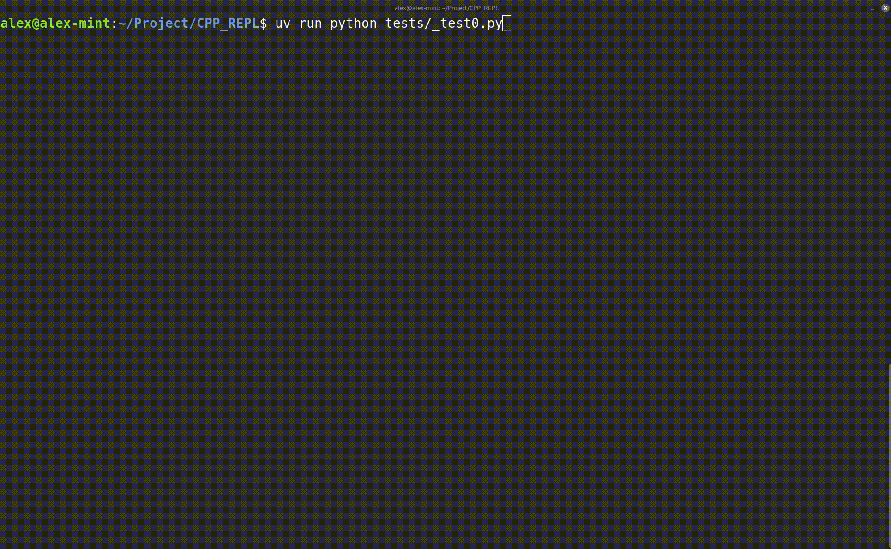

# CPP_REPL: Experimental

## Overview

The C++ REPL sits on LLVM's Clang frontend libraries and is driven from an interactive Python shell.

This interactive shell allows developers to run and test any C++ code on the fly.

This project is based on the concept of building the binary bridge between the C++ and Python runtimes.

## Preview (Demo)

Here is a showcase of what interacting with CPP_REPL feels like.

## Inspiration and Dependencies

This project is inspired by the [LLVM Compiler Infrastructure Project](https://github.com/llvm/llvm-project).

It integrates directly with LLVM's [Clang-Repl](https://clang.llvm.org/docs/ClangRepl.html) (the official Clang JIT / REPL).

The C++ REPL itself is _**NOT**_ built or implemented from scratch ***in any shape or form***; this project embeds and drives the existing clang-repl component.

## C++ Motivation

The motivation for most (if not all) of my research content is inspired by Decl as I have made most of these performance improvements during the development, designing, testing, and debugging of Decl. It has been a 2+ year progress as once you came up with a design, you are pretty much stuck with it forever, especially with the main focus on high performance.

To check out my YouTube channel, please visit: https://www.youtube.com/@AlexMilenkovic-ks7xd

The source code from the videos is published at https://github.com/BeAllAround/S2S-Compilers-Blog-Series-Public; related write-ups on https://dev.to/alex01.
